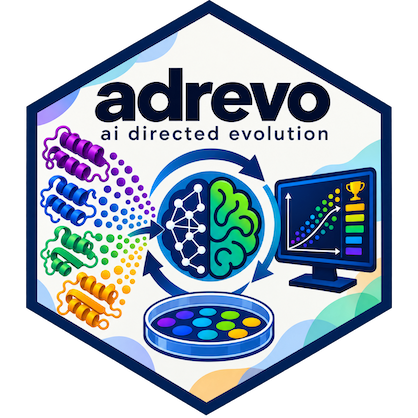

# adrevo <a href="https://zia1138.github.io/adrevo"></a>

**adrevo helps you plan and build research environments and evolve better algorithms with AI.** Inspired by systems like [ScientistTwo](https://arxiv.org/abs/2609.19644), it turns related work, existing code, and a research objective into a plan for fair comparisons and a trusted evaluator. That environment becomes the basis for discovery: language models propose algorithm improvements, the evaluator tests them, and adrevo keeps the candidates that score better.

Inspired by [AlphaEvolve](https://deepmind.google/discover/blog/alphaevolve-a-gemini-powered-coding-agent-for-designing-advanced-algorithms/), adrevo adds **adaptive backtracking** to program evolution: it explores locally improving branches, but when every configured model fails to improve a branch, it walks back up the last globally improving lineage and tries a different direction.

> Experimental software for research and algorithm development.

## Plan and build an evaluation environment

Start with a project containing `BACKGROUND.md` describing related work and, optionally, existing code or data. Planning is deliberately split into a scientific phase and an evaluation-design phase. Each command uses the Codex CLI and prints a session ID plus a command for resuming that stage interactively.

```bash
uv run adrevo research-plan my-project research-plans
uv run adrevo eval-plan research-plans eval-plans
uv run adrevo build eval-plans build-workspace
```

`research-plan` writes `RESEARCH_PLAN.md`. It selects one high-impact algorithm-discovery thesis from the related work and specifies the evidence required to support it: the measurements, correctness requirements, tradeoffs, relevant problem instances, experimental controls, and comparison methods.

`eval-plan` reads `RESEARCH_PLAN.md` and writes a self-contained `EVAL_PLAN.md`. It preserves the research thesis, defines the exact metrics and `combined_score`, and specifies a concrete, minimal evaluation harness: its files, algorithm interface, data, comparison implementations, dependencies, validation, resource budgets, and experimental controls.

`build` requires the self-contained `EVAL_PLAN.md` and `BACKGROUND.md`; it does not need `RESEARCH_PLAN.md`. It copies those two files into a new workspace, then writes `BUILD.md` with instructions for implementing and validating the evaluator and comparison algorithms.

## Run example evolution

Prerequisites: Python 3.13+, [uv](https://docs.astral.sh/uv/), a [Cerebras](https://www.cerebras.ai) API key, an [OpenAI](https://platform.openai.com) API key, and a [Logfire](https://logfire.pydantic.dev/login) account. Create a Logfire project named `adrevo` before continuing.

```bash
git clone https://github.com/zia1138/adrevo.git
cd adrevo
uv sync
export CEREBRAS_API_KEY=...
export OPENAI_API_KEY=...
logfire auth
logfire projects use adrevo
uv run adrevo run examples/circle_packing --config config_cerebras.py --verbose
```

`uv sync` creates Adrevo's environment from this repository's `pyproject.toml`. The `--verbose` flag sends run logs and Pydantic AI traces to Logfire. This evolves a solution for packing 26 circles in a unit square; results are written to a timestamped `results_*` directory. For a Ray cluster, make the resulting `.logfire/` credentials (or `LOGFIRE_TOKEN`) available on every node.

## How it works

Adrevo evolves candidate code; it does not decide whether that code is correct. You provide the trusted evaluator that does.

1. You provide a project with trusted `evaluate.py`, candidate files under the configured `evo_dir`, and a configuration.
2. Adrevo asks models for replacements of the configured candidate files. It never edits `evaluate.py`.
3. For each replacement, Adrevo runs `uv run python evaluate.py run <evo_dir>`. The evaluator builds and runs the candidate, validates its output, and writes `results.json`.
4. Adrevo reads `results.json` and keeps candidates with a better `combined_score`.

This boundary lets the evaluator stay stable and language-specific while the evolved candidate can use Python, Rust, Go, Node, or another runtime.

## Code-as-config: trusted evaluator contract and environments

Each project separates trusted evaluation from evolved code. This boundary keeps scoring stable while letting the candidate use any language or runtime.

There are three environments:

- **Adrevo:** the repository's `uv` environment runs the controller.
- **Evaluator:** your root project's `pyproject.toml` and `uv` environment run trusted `evaluate.py`, separately from Adrevo's controller dependencies. Include Typer in this environment.
- **Candidate:** the configured `evo_dir` (`evo/` by default) is built and run by the evaluator with uv, Cargo, Go, Node, Docker, or another runtime.

Manage dependencies for evolved code in `evo_dir` yourself—for example, in the default `evo/pyproject.toml`. Adrevo does not install or list them.

Each evaluation follows this contract:

```bash
uv run python evaluate.py run <evo_dir>
```

1. Adrevo copies the project, replaces the candidate files returned by the model, and invokes the Typer evaluator in the root project's `uv` environment.
2. Trusted `evaluate.py` builds and runs the candidate, then validates its output file.
3. The evaluator writes `results.json`; Adrevo reads it to decide whether the candidate improved.

The evaluator must write:

```json
{"correct": true, "error": null, "combined_score": 1.23}
```

`correct` is a boolean and `error` is a string or `null`. Larger `combined_score`
values are better by default; set `maximize_combined_score=False` in
`AdrevoConfig` when lower values are better. Adrevo never edits `evaluate.py`.

Create the project like this:

```text
my-project/
├── evaluate.py        # trusted evaluator; writes results.json
├── config.py          # models and run settings
├── pyproject.toml     # trusted evaluator dependencies, managed by uv
└── evo/               # evolvable candidate project
    ├── main.py        # writes a benchmark-defined output file
    └── pyproject.toml # candidate dependencies, if it uses uv
```

`config.py` is ordinary Python—not YAML. Define `get_adrevo_config()` there, and define `build_evo_models()` for the models Adrevo uses to evolve the candidate.

### Multiple evolvable files

`AdrevoConfig.evolvable_files` is the explicit allowlist of complete files Adrevo may modify. Each `EvolvableFile(file, lang_identifier)` gives a project-relative path under `evo_dir` and the Markdown fence language used to exchange that file with the model. `evo_dir` defaults to `evo`, and the default evolvable file is `evo/main.py` as Python.

Models return complete replacements for one or more allowlisted files; files omitted from a response remain unchanged. For example, allow the candidate's source and dependencies to evolve together:

```python
evolvable_files=(
    EvolvableFile("evo/main.py", "python"),
    EvolvableFile("evo/pyproject.toml", "toml"),
)
```

Run a project with:

```bash
uv run adrevo run my-project --config config_openai.py
```

Start from the [circle-packing example](examples/circle_packing), especially its [configuration](examples/circle_packing/config_openai.py) and [evaluator](examples/circle_packing/evaluate.py).

## How search works

1. Models propose complete replacements for one or more allowlisted candidate files; trusted `evaluate.py` runs them, validates their output, and reports a `combined_score`.
2. A new global best becomes the committed search lineage. A local improvement can be explored as a side branch without replacing that lineage.
3. If the final model in the configured model list cannot improve the current branch, adrevo backtracks one or more ancestors (`backtrack_steps`) and continues from there.

The evaluator may use either score direction; configure `maximize_combined_score`
accordingly. See [the configuration dataclasses](src/adrevo/config.py) for all settings.

## Benchmarks

Results use benchmark suites adapted from [skydiscover](https://github.com/skydiscover-ai/skydiscover). The OpenEvolve, GEPA, ShinkaEvolve, and AdaEvolve comparison rows are reported from the [AdaEvolve paper](https://arxiv.org/abs/2602.20133) with a GPT-5 backbone.
adrevo results were obtained using `config_cerebras.py` configurations.

### Mathematical optimization

| Strategy | Circle Packing ↑ | Circle Packing (Rect) ↑ | Heilbronn (Convex) ↑ | Heilbronn (Triangles) ↑ | MinMax Distance ↑ | Signal Processing ↑ |
|----------|-----------------:|------------------------:|---------------------:|------------------------:|------------------:|--------------------:|
| Human / SOTA | 2.634 | 2.364 | 0.0306 | 0.0360 | 0.2399 | – |
| AlphaEvolve | 2.635 | **2.3658** | 0.0309 | **0.0365** | 0.2398 | – |
| OpenEvolve | 2.541 | 2.276 | 0.027 | 0.028 | 0.2243 | 0.622 |
| GEPA | 2.628 | 2.354 | 0.027 | 0.032 | 0.2392 | 0.705 |
| ShinkaEvolve | 2.541 | 2.358 | 0.026 | 0.034 | 0.2398 | 0.533 |
| AdaEvolve | 2.63598308 | 2.361 | 0.029 | 0.036 | **0.2404** | 0.718 |
| **adrevo** | **2.63598308499572** | 2.3621 | **0.03092** | **0.0365** | 0.2401 | **0.956** |
| Cost (adrevo) | $1.27 | $1.81 | $3.16 | $4.61 | $1.62 | $2.61 |

adrevo beats SOTA on 3/5 mathematical-optimization benchmarks.

### ADRS

| Strategy | Cloudcast ↓ | EPLB ↑ | Prism ↑ | LLM-SQL ↑ | TXN ↑ |
|----------|------------:|-------:|--------:|----------:|------:|
| Human / SOTA | 626.2 | 0.1265 | 21.89 | 0.692 | 2,725 |
| OpenEvolve | 729.8 | 0.1272 | 26.23 | 0.716 | 4,329 |
| GEPA | 645.7 | 0.1445 | 26.23 | 0.713 | 3,984 |
| Shinka | 812.7 | 0.1272 | 26.26 | 0.713 | 4,329 |
| AdaEvolve | 640.5 | 0.1453 | **26.37** | 0.775 | **4,348** |
| **adrevo** | **618.07** | **0.1516** | 25.26 | **0.9893** | 4,273.50 |
| Cost (adrevo) | $3.20 | $1.99 | $0.22 | $1.11 | $1.46 |

adrevo beats SOTA on 3/5 ADRS benchmarks.

## Related Work

[AlphaEvolve](https://deepmind.google/discover/blog/alphaevolve-a-gemini-powered-coding-agent-for-designing-advanced-algorithms/), [ShinkaEvolve](https://github.com/SakanaAI/ShinkaEvolve), [OpenEvolve](https://github.com/algorithmicsuperintelligence/openevolve), [LLM4AD](https://github.com/Optima-CityU/llm4ad), [skydiscover / AdaEvolve](https://github.com/skydiscover-ai/skydiscover), [GigaEvo](https://github.com/AIRI-Institute/gigaevo-platform/tree/main), [station](https://github.com/dualverse-ai/station), [autoresearch](https://github.com/karpathy/autoresearch), [GEPA](https://github.com/gepa-ai/gepa), [CodeEvolve](https://github.com/inter-co/science-codeevolve), [ThetaEvolve](https://github.com/ypwang61/ThetaEvolve), [TTT-Discover](https://github.com/test-time-training/discover), [Guidance-TTT](https://github.com/Human-Agent-Society/reef/tree/guidance-ttt-support), [ScientistTwo](https://scientist-two.github.io), [autoresearch](https://github.com/karpathy/autoresearch), [RD-Agent](https://github.com/microsoft/RD-Agent), [Agent Laboratory](https://github.com/SamuelSchmidgall/AgentLaboratory), [AI-Scientist](https://github.com/SakanaAI/AI-Scientist), [AI-Scientist-v2](https://github.com/SakanaAI/AI-Scientist-v2), [AutoResearchClaw](https://github.com/aiming-lab/AutoResearchClaw), [ClawPhD](https://github.com/ZhihaoAIRobotic/ClawPhD), [Dr. Claw](https://github.com/OpenLAIR/dr-claw), [FARS](https://analemma.ai/fars), [EvoScientist](https://github.com/EvoScientist/EvoScientist), [ScienceClaw](https://github.com/beita6969/ScienceClaw), [claude-scholar](https://github.com/Galaxy-Dawn/claude-scholar), [Research-Claw](https://github.com/wentorai/Research-Claw), [DeepScientist](https://github.com/ResearAI/DeepScientist), [CycleResearcher](https://github.com/zhu-minjun/Researcher), [AutoSOTA](https://github.com/tsinghua-fib-lab/AutoSOTA), [Google Teamwork](https://antigravity.google/blog/teamwork-when-ai-becomes-a-research-partner), [AutoReproduce](https://github.com/AI9Stars/AutoReproduce), [RECLAIM](https://github.com/mithils3/reclaim), [ICML 2026 Repro Challenge](https://huggingface.co/ICML-2026-agent-repro/challenge), [SIA](https://github.com/hexo-ai/sia), [AI-Scientist-v3](https://github.com/SakanaAI/AI-Scientist-v3), [auto-optimize](https://github.com/macs3-project/MACS/pull/756)
